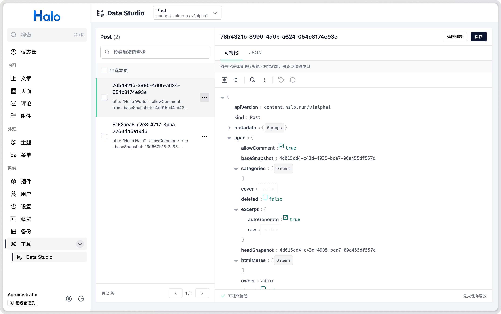

# Data Studio（数据工厂）

Halo 的数据维护插件，支持查询系统内所有模型，以及维护任意模型数据。

## ⚠️ 警告

此功能拥有极高的数据操作灵活度，在进行操作之前请务必熟悉 Halo 的运行机制，避免造成数据异常或者不完整。在进行某些数据修改前也请尽可能提前备份数据。

相关资料：

- [自定义模型设计](https://github.com/halo-dev/rfcs/tree/main/extension)
- [Halo 架构概览](https://docs.halo.run/developer-guide/core/framework)

## 特性

- 支持列出系统内所有已加载的模型。
- 支持对模型数据的 CRUD。
- 支持数据的可视化编辑。
- 支持导入导出数据。

## 预览



## 开发环境

- Java 21
- Node.js >=22.12.0
- pnpm 12.16.1
- Halo >=2.27.0

## 开发

启动 Halo 并加载插件：

```bash
./gradlew haloServer
```

在另一个终端监听 UI 变更：

```bash
cd ui
pnpm install
pnpm dev
```

开发模式将 UI 产物写入 `build/resources/main/ui`。

## 构建

```bash
./gradlew clean build
```

Gradle 会安装 UI 依赖、执行类型检查和 Vite 构建，并将 `ui/build/dist` 下的完整 ESM 产物打包进插件 JAR 的 `ui/` 目录。构建结果位于 `build/libs`。
